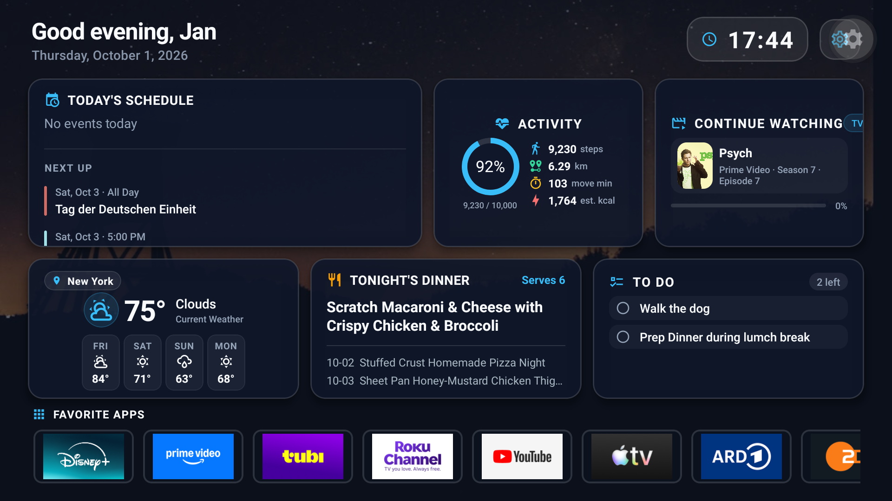

# HomeScreen — A Personal Dashboard for Smart TVs

HomeScreen explores a calm, customizable, ad-free TV home screen built around the household using it. The original motivation remains: **a Smart TV screen that is useful even when nobody is actively watching it.**

The project targets a 10-foot Android TV / Google TV experience using Expo, React Native TV, TypeScript, Firebase, and a phone-friendly companion site. It is an active personal project with substantial working features, not a finished launcher replacement.



This October 1, 2026 screenshot predates polls, shared activity, reading controls, and the latest settings/detail layouts. More screenshots are in the [TV app guide](HomeScreen/README.md#screenshots).

## Current scope

Implemented in source, reconciled with git history through `55ef529` on October 23, 2026:

- Schedule, tasks with completion, activity/goals, weather/forecasts, optional meal Sheets, and Continue Watching with supported Android Play Next intents.
- Favorite installed apps, remote-selectable detail panels, TV pairing, encrypted server-side Google credentials, connection controls, and individually managed TV sessions.
- Automatic rows or a bounded 12×6 widget canvas, visibility/order/sizing, card styles, background photos, ambient mode, and synchronized account appearance.
- Companion drafts, Undo/Redo, named designs, published history, weather/goals, Photos selection, and per-TV favorite apps.
- Reusable household polls, QR voting, results, independently arranged poll widgets, and limited multiple-choice creation on the TV.
- Consented activity sharing from other Google accounts, with one activity widget per person.
- OpenDyslexic and reading controls, optional device-local spoken navigation, and responsive settings/detail layouts.
- Multiple RSS/Atom feed widgets, companion presets/custom URLs/previews, and TV source selection, story summaries and QR links. Added October 10; see [Feed widgets](server/pairing-web/FEEDS.md).
- Account-scoped cached startup, foreground/resume refresh with retries, improved weather freshness, cached installed apps/artwork, return-focus memory, local reduced motion, and Android TV controls under Settings → Device.

**Most of the core household dashboard is implemented.** The broader vision is still incomplete: personal profiles, independent per-TV layouts, watchlists/recently watched, a broader media catalog, calendar week/month views, full task editing, universal search, smart-home integrations, and automatic time-of-day modes remain open.

Source completion does not establish production availability. October 22 evidence records signed APK verification, an in-place Sony TV update, five benchmark passes per build and Device-panel inspection. Frame results were mixed; broader remote, ambient, standby, accessibility and integration checks remain open. This October 23 documentation audit did not inspect production or build/install an APK. See [project status and release evidence](docs/PROJECT_STATUS.md).

**Next:** finish the current-build TV smoke pass and capture a controlled rendering trace; start activity-provider migration feasibility alongside that work. The [next-step plan](docs/NEXT_STEPS.md) explains the order, reasons and completion gates.

## Start here

| Purpose | Guide |
| --- | --- |
| Progress against the original vision; remaining priorities | [Project status](docs/PROJECT_STATUS.md) |
| Ordered work, reasoning and completion evidence | [Next steps](docs/NEXT_STEPS.md) |
| All documentation and placement rules | [Documentation index](docs/README.md) |
| Run, configure, and use the TV app | [TV README](HomeScreen/README.md) |
| Signed releases, network installation, Google Play | [Release guide](HomeScreen/RELEASE.md) |
| Backend APIs, configuration, local development | [Functions README](server/functions/README.md) |
| Companion setup and household workflows | [Companion README](server/pairing-web/README.md) |
| Current product roadmap | [Roadmap](server/pairing-web/COMPANION_ROADMAP.md) |
| Security, retention, and release review | [Security setup](server/SECURITY.md), [dated review](server/SECURITY_REVIEW.md) |

From the repository root, the common checks are:

```sh
npm run typecheck
npm test
npm --prefix server/functions run lint
npm --prefix server/pairing-web run build
```

Install dependencies in each component first; each has its own package and configuration. Browser fixtures, emulator transactions, real Google consent, and physical TV checks are separate; follow the component and feature guides.

## Original intent

The design principles remain information at a glance, no advertising, user-controlled content, readable typography, clear hierarchy, D-pad navigation, customization, minimal interruptions, and usefulness while idle.

The [retained README snapshot](docs/vision/original-readme.md) and [original TV design specification](docs/vision/tv-ui-design.md) preserve the longer vision. Their proposed experiences are distinguished from implemented behavior by the [current status checklist](docs/PROJECT_STATUS.md).
